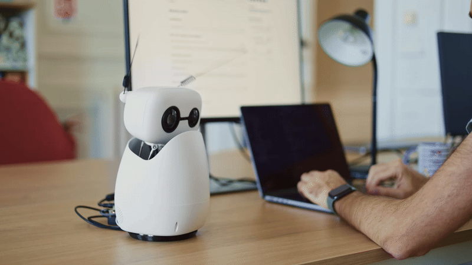
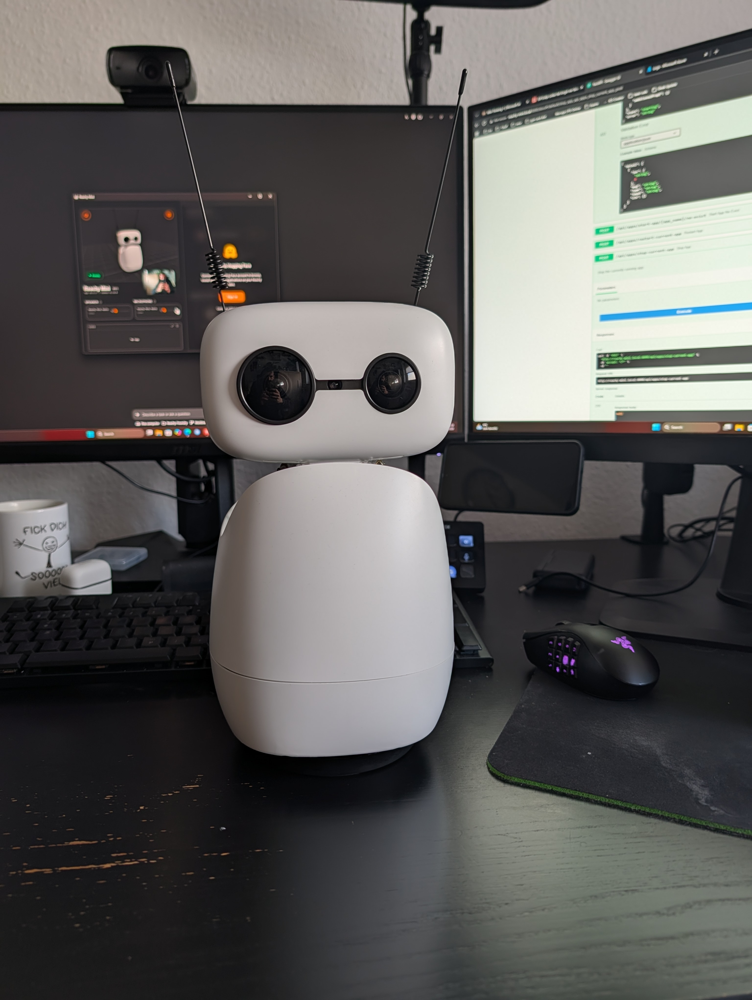
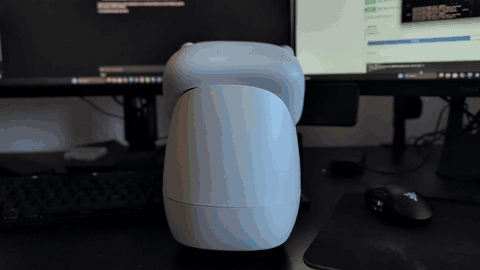
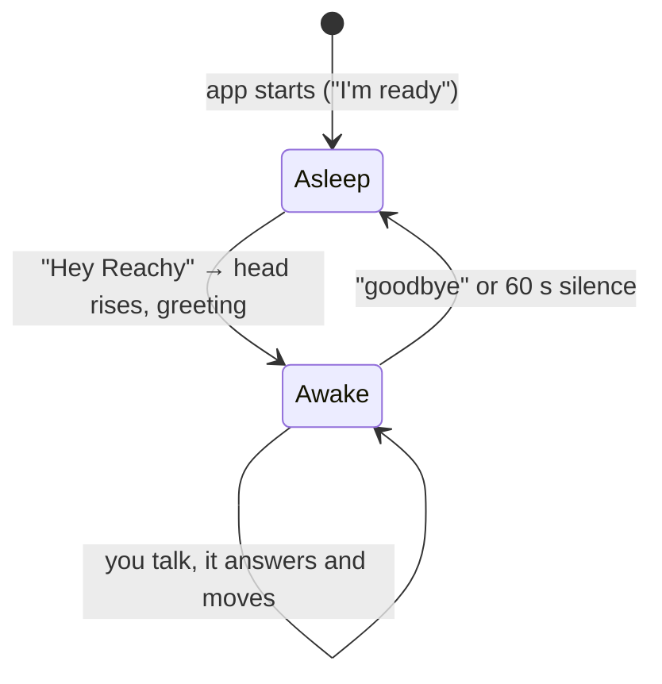
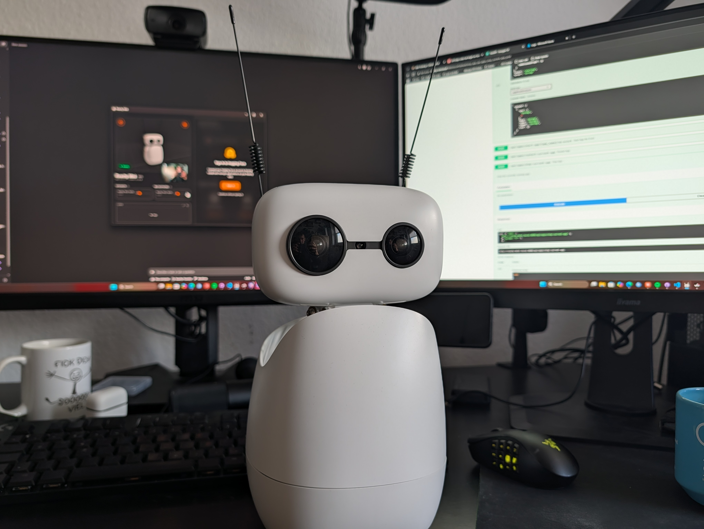

# Reachy-Foundry 🤖☁️

[](https://pollen-robotics.com/reachy-mini/)
[](https://ai.azure.com/)
[](https://learn.microsoft.com/agent-framework/)
[](reachy_foundry_agent/pyproject.toml)

**Talk to a [Reachy Mini Wireless](https://pollen-robotics.com/reachy-mini/) that thinks with Microsoft Foundry and moves like it means it.** 🗣️🧠🕺

[](https://pollen-robotics.com/reachy-mini/)

<sub>Animation © [Pollen Robotics / Hugging Face](https://github.com/pollen-robotics/reachy_mini), from their repo.</sub>

A sample for wiring a Reachy Mini (Wi-Fi edition) to Microsoft Foundry, with the
[Microsoft Agent Framework](https://learn.microsoft.com/agent-framework/) as the glue. The app runs *on the robot*. No laptop leash. 🐕‍🦺❌

## 💡 Why does this exist?

When the Reachy Mini was announced, I wanted one. In April (I guess) it arrived, I assembled it... and then it sat on my desk looking cute and doing nothing. 🪑

Now I finally decided to dive in. Not gonna lie, coding agents made this a lot easier. 🤖🤝🧑‍💻

The goal: **talk to it and give it tasks.** Besides answering, the robot should also use its body: nod, shake its head, wiggle its antennas, even dance. 💃

The architecture was already in my head:

- 🎙️ A Microsoft **MAI** model for transcription (`MAI-Transcribe-2`) and voice (`MAI-Voice-2.1-Flash`)
- 🧠 A **chat/reasoning model** for the answers. I went with `gpt-6.1-astra`, because I still plan to add the camera 📷. Otherwise I would have loved to try MAI Thinking 1.

<p align="center">
  
  <br><sub>Reachy, moments before judging my code 👀</sub>
</p>

## 🎬 Watch it tell a joke

[](docs/assets/video/tell-me-a-joke.mp4)

It laughs at its own jokes, afterwards, with its whole body. 😂 Click the GIF for the [full video with sound](docs/assets/video/tell-me-a-joke.mp4) 🔊.

## ⚙️ How it works

```
🎤 mic → energy VAD → 📝 Azure Speech STT (MAI-Transcribe) → 🚪 wake-phrase gate
   → 🧠 Agent Framework agent (Foundry model + 🦾 robot tools)
   → 🔊 Azure Speech TTS (MAI-Voice) → speaker
```

Reachy sleeps 😴 until it hears **"Hey Reachy"** 👋. While asleep, everything it hears is thrown away, never sent to the model. Say **"goodbye"** and it says bye and goes back to bed (so does 60 s of awkward silence 🦗).



Details in [docs/wake-and-goodbye.md](docs/wake-and-goodbye.md).

## 🚀 Try it

Prerequisites: [`azd`](https://aka.ms/azd), Azure CLI, Python 3, a Reachy Mini Wireless on your network.

```bash
azd auth login
azd up                                  # ☁️ Foundry, model deployment, Speech
./scripts/deploy-to-robot.sh            # 🤖 or .\scripts\deploy-to-robot.ps1 on Windows
```

Then open `http://reachy-mini.local:8000`, start **reachy_foundry_agent** and say hi. 👋
Headless auth, other models and troubleshooting are in the docs.

## 📚 Docs

| | |
|---|---|
| 🏗️ [Architecture](docs/architecture.md) | the pieces and how a voice turn flows |
| 🧠 [The agent](docs/agent.md) | instructions, session handling, Agent Framework setup |
| 🦾 [Robot tools](docs/tools.md) | everything the model can make the robot do |
| 🎙️ [Models](docs/models.md) | MAI STT/TTS, chat model, how to swap |
| 😴 [Wake & goodbye](docs/wake-and-goodbye.md) | the conversation gate |
| ☁️ [Infrastructure](docs/infrastructure.md) | Bicep, `azd`, roles |
| 🚚 [Deploying to the robot](docs/deployment.md) | scripts, service principal, config |

## 🚧 Status

Runs on a real robot (see the video) ✅. The camera tool and on-robot person detection exist in the code but are **not wired in yet**, so for now Reachy honestly tells you it can't see. 🙈 That's the next step.

<p align="center">
  
</p>

## 🧹 Clean up

```bash
azd down --purge
```
