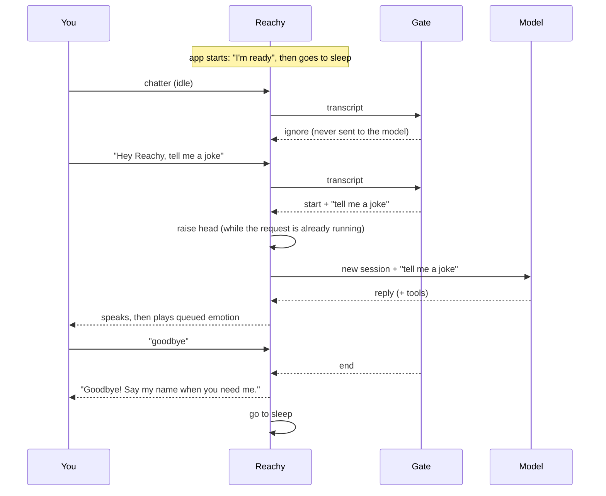

# 😴 Wake and goodbye

Reachy does not listen to you all day. The `ConversationGate` (`gate.py`) decides what happens with every transcribed utterance.

## 🌙 Idle (asleep)

- Every utterance is transcribed (so the audio does reach Azure Speech) and checked for a **start phrase**, then **dropped**. The text never reaches the chat model.
- Matching is **fuzzy** (`SequenceMatcher`, ratio ≥ 0.7), because speech-to-text loves to mishear names.
- Logs only show the *word count* of dropped utterances, unless `REACHY_DEBUG_GATE=1`.
- The idle microphone threshold is lower (`0.008` RMS vs `0.015`), because the folded-down sleeping head muffles the mic.

## 👋 Start

On a start phrase the gate becomes active and a **fresh agent session** is created. The head rises in parallel to the model call and the app waits for it before speaking, so Reachy never talks with its head still down.

- Bare "Hey Reachy" → the model gets a hint to greet and ask what's up.
- "Hey Reachy, what time is it" → the question is answered directly.

## 🛏️ Goodbye

An end phrase only counts in a **short utterance** (at most phrase length + 3 words) and must match strictly (ratio ≥ 0.85). So "goodbye" and "ok bye Reachy" end the conversation, but "by the way, ..." does not.

On goodbye: the session is dropped, any queued emotion is cleared, Reachy says bye and goes to sleep.

## ⏱️ Timeout

After `REACHY_CONVERSATION_TIMEOUT_S` (default 60) of silence the conversation ends quietly and Reachy goes back to sleep. The clock starts at the **end of the reply**, not at your question, so long answers don't eat your thinking time. `0` disables it.

## ⚙️ Settings

| Variable | Default |
|---|---|
| `REACHY_START_PHRASES` | `hey reachy,hello reachy,hi reachy,ok reachy` |
| `REACHY_END_PHRASES` | `goodbye,bye,end conversation,stop conversation` |
| `REACHY_CONVERSATION_TIMEOUT_S` | `60` |
| `REACHY_IDLE_VAD_THRESHOLD` | `0.008` (lower it if "Hey Reachy" isn't picked up while asleep) |
| `REACHY_DEBUG_GATE` | off |
